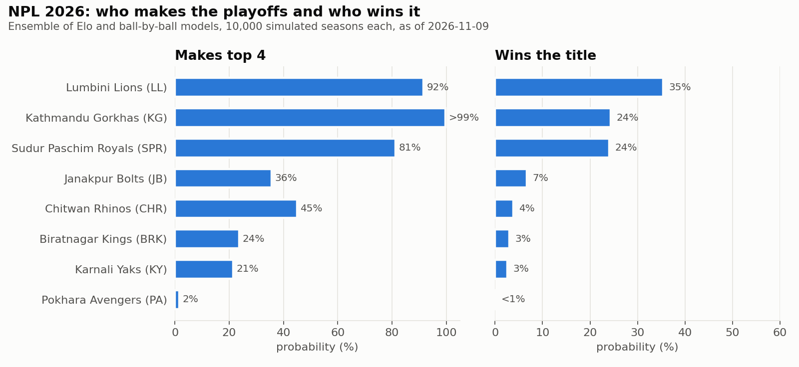
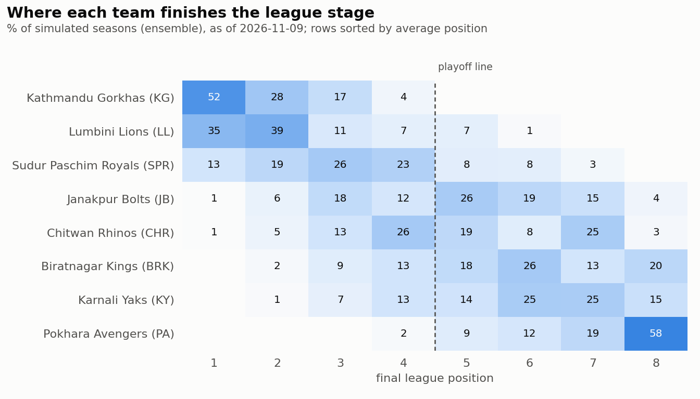
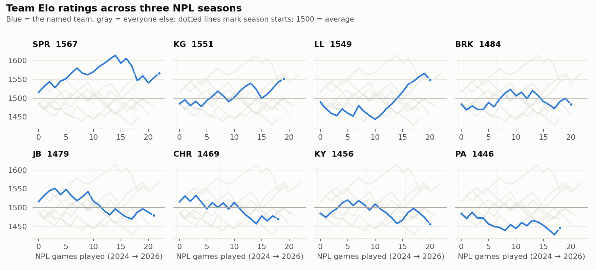
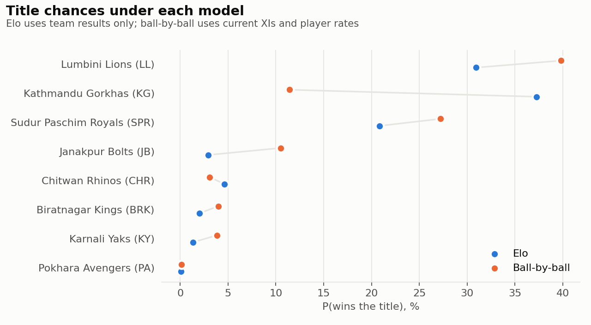

# NPL Monte Carlo

Who will make the playoffs, top the table and win the **Nepal Premier League 2026**? This
project simulates the rest of the season 10,000 times with two match models, one built on
team results (Elo) and one on players (ball-by-ball), and applies the real points table,
net run rate tie-break and playoff bracket.

**Status: finished snapshot.** The forecast was made on 10 November 2026, after match 20 of 28
and before the playoffs (final on 21 November). It is not updated as the season goes on.
Companion project: [World Cup 2026 forecast](https://github.com/Praruj/worldcup_prediction_2026)
(football, Elo + 100,000 simulated tournaments).

```bash
pip install -r requirements.txt
python run.py            # downloads data on first run, ~2 minutes end to end
python -m pytest         # simulator, table/NRR and model tests
```

## Results

<!-- RESULTS:START -->
_Generated by `python run.py --sims 10000 --seed 7`. Table includes every game up to 2026-11-09._

| Team | P | Pts | NRR | Top of table | Top 4 | Final | Title | Title (Elo) | Title (ball-by-ball) | Title (pre-season, ball-by-ball) |
|---|---:|---:|---:|---:|---:|---:|---:|---:|---:|---:|
| Lumbini Lions | 5 | 7 | +1.501 | 35% | 92% | 66% | **35%** | 31% | 40% | 22% |
| Kathmandu Gorkhas | 5 | 8 | +1.168 | 52% | >99% | 55% | **24%** | 37% | 11% | 1% |
| Sudur Paschim Royals | 5 | 6 | -0.275 | 13% | 81% | 43% | **24%** | 21% | 27% | 23% |
| Janakpur Bolts | 5 | 4 | -0.083 | 1% | 36% | 13% | **7%** | 3% | 11% | 22% |
| Chitwan Rhinos | 5 | 5 | +0.009 | 1% | 45% | 10% | **4%** | 5% | 3% | 3% |
| Biratnagar Kings | 5 | 4 | -0.820 | <1% | 24% | 7% | **3%** | 2% | 4% | 14% |
| Karnali Yaks | 5 | 4 | -0.846 | <1% | 21% | 6% | **3%** | 1% | 4% | 13% |
| Pokhara Avengers | 5 | 2 | -0.707 | 0% | 2% | <1% | **<1%** | <1% | <1% | 3% |





**Remaining league games** (probability the first-named team wins):

| # | Date | Game | Elo | Ball-by-ball | Ensemble |
|---:|---|---|---:|---:|---:|
| 21 | 2026-11-10 | Sudur Paschim Royals v Janakpur Bolts | 62% | 52% | 57% |
| 22 | 2026-11-12 | Biratnagar Kings v Pokhara Avengers | 55% | 63% | 59% |
| 23 | 2026-11-12 | Karnali Yaks v Lumbini Lions | 37% | 44% | 40% |
| 24 | 2026-11-13 | Kathmandu Gorkhas v Sudur Paschim Royals | 48% | 26% | 37% |
| 25 | 2026-11-13 | Janakpur Bolts v Chitwan Rhinos | 51% | 67% | 59% |
| 26 | 2026-11-14 | Biratnagar Kings v Lumbini Lions | 41% | 46% | 43% |
| 27 | 2026-11-15 | Chitwan Rhinos v Karnali Yaks | 52% | 40% | 46% |
| 28 | 2026-11-15 | Pokhara Avengers v Kathmandu Gorkhas | 35% | 59% | 47% |

**Backtest** (NPL 2025 and 2026 games with Cricsheet line-ups, predicted before each game; lower log loss / Brier is better):

| Model | Games | Log loss | Brier | Accuracy |
|---|---:|---:|---:|---:|
| Coin flip | 44 | 0.693 | 0.250 | 45% |
| Elo | 44 | 0.693 | 0.250 | 43% |
| Ball-by-ball | 44 | 0.688 | 0.248 | 50% |
| Ensemble | 44 | 0.687 | 0.247 | 45% |

**Calibration check:** simulated first-innings totals at Kirtipur average 149 (sd 23) against 148 (sd 29) in real NPL games; the chasing side wins 54% of simulated games and 50% of real ones.

**Elo settings:** K = 16, 25% regression to 1500 between seasons, chase bonus +0 points. No-result chance per remaining league game: 1.9%.





<details><summary>Batting orders and bowlers used for the remaining games</summary>

- **Biratnagar Kings**: GSNFG Jayasuriya, Lokesh Bam, Imran Sheikh, AD Russell, Shubham Ranjane, AD Mathews, Basir Ahamad, N Joshi, A Poudel, S Lamichhane, Rupesh Singh. Bowlers: AD Russell, S Lamichhane, AD Mathews, Rupesh Singh, A Poudel.
- **Chitwan Rhinos**: D Khanal, DJ Malan, A Saud, RS Bopara, Sikandar Raza, B Yadav, TAI Taylor, R Dhakal, KS Airee, R Kumar, SM Dhakal. Bowlers: R Kumar, SM Dhakal, TAI Taylor, R Dhakal, KS Airee.
- **Janakpur Bolts**: MM Ali, TR Das, Saif Hassan, AK Sah, B Shusling, JDS Neesham, Harmeet Singh, Abhisekh Tiwari, LN Rajbanshi, Rahul Yadav, AS Routela. Bowlers: Harmeet Singh, LN Rajbanshi, MM Ali, Rahul Yadav, Saif Hassan.
- **Karnali Yaks**: Ariful Islam, Jishan Alam, MRJ Watt, DA Miller, Deepak Dumre, P Sarraf, Hussain Talat, Gulsan Jha, Sompal Kami, NK Yadav, UBS Thakuri. Bowlers: Hussain Talat, NK Yadav, MRJ Watt, Sompal Kami, UBS Thakuri.
- **Kathmandu Gorkhas**: DA Warner, Mohammad Aadil Alam, Rashid Khan, B Sharki, Karan KC, SSD Arachchige, Jahandad Khan, Santosh Yadav, D Shah, R Mondol, Shahab Alam. Bowlers: Shahab Alam, Karan KC, R Mondol, Jahandad Khan, D Shah.
- **Lumbini Lions**: Aasif Sheikh, DJM Short, RK Paudel, N Dickwella, Shamim Hossain, TR Bhandari, S Jora, R Trumpelmann, Abhishesh Gautam, K Mahato, S Malla. Bowlers: S Malla, TR Bhandari, K Mahato, R Trumpelmann, Abhishesh Gautam.
- **Pokhara Avengers**: Arjun Kumal, YS Samra, K Bhurtel, S Samarawickrama, B Acharya, Shakib Al Hasan, Mahedi Hasan, A Gharti, C Karunaratne, K Thagunna, Bipin Khatri. Bowlers: Mahedi Hasan, Shakib Al Hasan, K Bhurtel, Bipin Khatri, C Karunaratne.
- **Sudur Paschim Royals**: SA Zaib, B Bhandari, BJ McMullen, I Pandey, DS Airee, Aarif Sheikh, SE Rutherford, SC Kuggeleijn, A Kharel, H Dhami, A Bohara. Bowlers: SC Kuggeleijn, DS Airee, H Dhami, A Kharel, A Bohara.

</details>
<!-- RESULTS:END -->

## Data

| What | Source | Notes |
|---|---|---|
| NPL 2024, 2025 and 2026 (to match 13) ball by ball | [Cricsheet](https://cricsheet.org/downloads/) `npl_json.zip` | 76 games, all at Tribhuvan University ground, Kirtipur |
| Men's T20 internationals since 2021, ball by ball | Cricsheet `t20s_male_json.zip` | ~2,750 games; used as priors for players with little NPL data (Nepal's own T20Is included) |
| NPL 2026 fixtures and results for matches 14-20 | [Wikipedia: 2026 Nepal Premier League](https://en.wikipedia.org/wiki/2026_Nepal_Premier_League), retrieved 2026-11-10 | Hand-entered in `data/manual/npl_2026_fixtures.csv` |
| Late arrivals to three XIs | Same Wikipedia scorecard summaries | `data/manual/lineup_additions.json` |

Checks on the hand-entered data (all in `tests/test_table.py`):

* Matches 1-13 in the CSV agree with Cricsheet run for run, wicket for wicket and ball for
  ball. This caught one error in the Wikipedia summary: match 11's chase took 16.4 overs, not 20.
* The points table rebuilt from the CSV matches Wikipedia's table. Its NRR column agrees to
  three decimals up to match 19; Wikipedia had not yet updated NRR for match 20, and
  including it moves Kathmandu to +1.168 and Chitwan to +0.009.

ESPNcricinfo blocks automated requests (HTTP 403) and was not used. Cricsheet does not
publish Afghanistan's T20Is, so Afghan players get no T20I prior. Cricsheet data is open
under ODC-BY 1.0; the raw files are not stored in this repo and `run.py` downloads them.

## Method

**Elo (team results).** Every team starts at 1500 in 2024. After each game, ratings move by
K × margin multiplier × (result - expectation). A 40-run win, or its equivalent in a chase
(1.25 runs per ball to spare, 3 per wicket in hand), counts double. Between seasons, ratings
are pulled back towards 1500 because NPL squads turn over at each auction. K and the
pull-back are chosen by log loss on 2025-26. The chasing side's edge is set from the NPL's
own chase win share. It is 49%, so in practice there is no edge.

**Ball-by-ball (players).** Every legal ball is one of 0, 1, 2, 3, 4, 6 or a wicket. The
baseline probabilities come from the NPL alone, split by innings and phase (powerplay,
middle, death), so scoring is calibrated to Kirtipur rather than to global T20 averages.
Each batter and bowler has a multiplier per outcome:

    mult = (observed + k·prior) / (expected + k·prior)

Here `expected` is what an average player would have produced on the same balls in the same
competition, innings and phase. So a T20I ball is judged against T20I norms, and only the
*relative* effect carries over to Kirtipur. T20I balls carry 0.6 weight, all balls decay
with a two-year half-life, and k = 120 (batting) or 150 (bowling) pseudo-balls pull players
with thin records towards average. Each side bats in the order of its most recent recorded
XI. Its five most-used bowlers bowl four overs each in a fixed rotation. Wides and no-balls
add a run and a re-bowl at the NPL rate, and a tied game goes to a coin-flip super over.

**Season.** Played games are fixed. Each remaining league game is simulated in full, so the
score line feeds NRR: a side bowled out counts as facing its full 20 overs. A game is lost
to weather with probability (washouts + 0.5) / (games + 1) = 1.9%, worth one point each.
Teams are ranked on points, then NRR, then a coin flip. The top four go into the playoffs:
Qualifier 1 (1st v 2nd), Eliminator (3rd v 4th), Qualifier 2 (loser of Q1 v winner of the
Eliminator) and the Final. The headline numbers average the two models' season odds.

**Backtest.** Each NPL 2025 and 2026 game with a Cricsheet scorecard is predicted using only
data from before that day. The ball-by-ball model is refitted on earlier balls and given the
two real XIs and the real batting order.

## Limits

* **Short history.** 44 backtest games is a small sample. Elo does no better than a coin
  flip, and the ball-by-ball model and the ensemble beat it only slightly, so treat a 60/40
  game as genuinely uncertain. NPL results have so far been close to a lottery, which is
  also why the season odds are spread out.
* **The two models disagree most about Kathmandu.** Their 4-1 start lifts their Elo, but most
  of their XI has little recorded T20 data, so the player model rates them about average (before
  the season it gave them a 1% title chance, the lowest of any team).
  The ensemble splits the difference; the real answer is probably in between.
* **Line-ups are fixed.** Every remaining game uses the latest XI on record (Cricsheet stops
  at match 13), plus three players who appeared later. Injuries, rotation and tactical
  changes are not modelled.
* **Simple game state.** Batters do not speed up when the asking rate climbs, and the order
  does not change with the match situation. Simulated chases win 54% of the time against 50%
  in real NPL games, and simulated totals spread a little less than real ones.
* **Elo score lines** are drawn from real NPL margins regardless of the rating gap, so NRR
  under that model is noisier than in reality.
* **No playoff washouts**, no reserve-day rules and no DLS: reduced games happen in the
  record but not in the simulation.

## Re-running with more results

The project is frozen at match 20, but it still works with later results. Fill in a game's
row in `data/manual/npl_2026_fixtures.csv` (side batting first, runs/wickets/overs for both
innings, winner, `status=result` or `no_result`) and run `python run.py` again. Use
`--refresh` after re-downloading Cricsheet data.

## Layout

```
run.py                     one command: data -> models -> backtest -> simulation -> charts -> README
npl/data.py                Cricsheet download + parsing, fixture CSV
npl/table.py               points, NRR, ranking
npl/elo.py                 Elo ratings and tuning
npl/players.py             player rate multipliers, line-ups, bowling rotation
npl/models.py              Elo and ball-by-ball match simulators (vectorised over seasons)
npl/season.py              league + playoff Monte Carlo
npl/backtest.py            out-of-sample match predictions
npl/charts.py              figures in results/
data/manual/               hand-entered 2026 fixtures and late line-up additions
results/                   CSVs, summary.json and charts written by run.py
tests/                     pytest suite
```

## Licence

Code: MIT (see `LICENSE`). Match data: [Cricsheet](https://cricsheet.org/), ODC-BY 1.0, downloaded at run time and not redistributed here.
